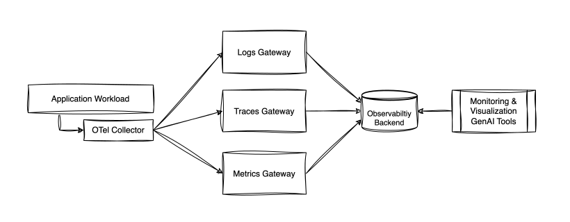
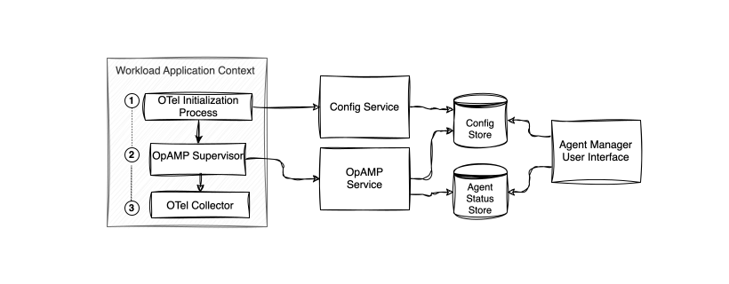
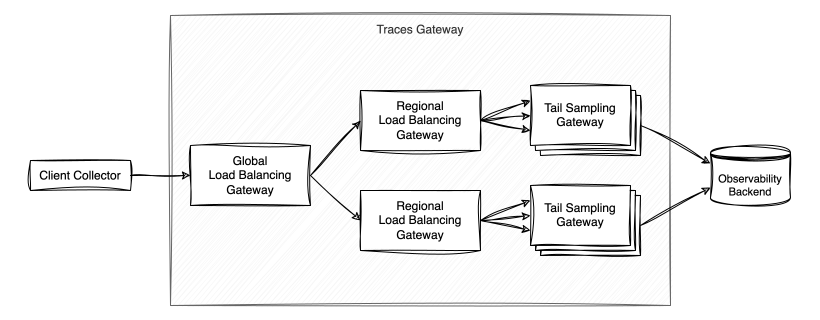
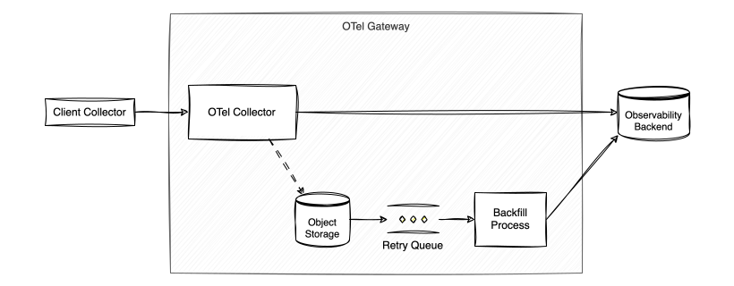

## Relevant CNCF projects


  
  [](https://www.cncf.io/projects/opentelemetry/)

  Our enterprise observability standard — one open framework for metrics, traces, and logs.
  

  
  [](https://www.cncf.io/projects/prometheus/)

  Interoperable with OpenTelemetry — OTel metrics export directly to Prometheus-compatible tooling.
  

  
  [](https://www.cncf.io/projects/kubernetes/)

  A core container platform our workloads run on.
  


## TL;DR / Synopsis

### Why Capital One Chose OpenTelemetry

Our customers expect their banking, card transactions and every digital interaction to be available the moment they need it — paying using their credit card, checking a balance at 2am, moving money before a bill is due.
At that scale and expectation, observability isn't optional.
It's a critical part of the infrastructure that makes our goal of an “always on” digital experience possible.
Capital One adopted OpenTelemetry as its observability framework, replacing legacy telemetry tooling with a single open standard for Metrics, Traces, and Logs.  
    
To scale OpenTelemetry to petabytes of telemetry ingestion into our Observability backend, we run OpenTelemetry infrastructure for Logs, Metrics and Traces consisting of OpenTelemetry collectors and signal-based gateways at each stage of the telemetry pipeline.
This structure allows us to deliver petabytes of rich, actionable telemetry in a resilient and scalable way.

This OpenTelemetry based architecture gives Capital One four strategic advantages from a telemetry signal generation standpoint:

* **Greater data ownership.** Telemetry generation and routing live within our own infrastructure, giving us more control over how and where our data is used, even as we partner with best-in-class vendors downstream.  
* **Flexibility.** Because it's built on open standards, we can integrate with multiple backends without any reinstrumentation, giving us the freedom to choose the right partner for the right use case.  
* **Resilience during disruptions.** Dedicated telemetry gateways help absorb backend disruptions, so our availability of telemetry is more resilient even when a given platform experiences issues.  
* **Room to extend and customize.** Custom semantic conventions and the Collector's modular architecture let us layer in internal standards and tailor the framework to our needs, working alongside vendor roadmaps rather than waiting solely on them.

In short, Capital One chose OpenTelemetry because it helps turn observability into an enterprise capability, one that gives us flexibility and control while we continue to build strong partnerships with our observability vendors.

## Organization

Capital One has been cloud-first on AWS since 2015 and has a very large AWS footprint.
At our current scale, maintaining deep system observability requires constant innovation and presents unique challenges.
Teams choose the best fit languages and frameworks for their domain, and services are deployed across diverse cloud infrastructure.
Over time, this led to Observability vendor sprawl: multiple monitoring and APM tools evolved across the enterprise, each with its own agent, its own data model, and its own silo.

The biggest cost of that sprawl was the inability to easily correlate telemetry.
A trace captured by one vendor's agent couldn't be joined with metrics or logs captured by others.
Diagnosing an issue that crossed team boundaries meant stitching together disconnected dashboards by hand, and any platform migration required reinstrumenting hundreds of services simultaneously, since every vendor's SDK was wired directly into application code.

The Enterprise Observability team exists to solve that at scale, providing a shared, vendor-neutral, OpenTelemetry-based observability framework and infrastructure that any team can use, regardless of language, framework, or compute platform, so that every signal, from every service, speaks the same language and can be correlated end to end.

## Architecture Overview & Goals

Our OpenTelemetry based architecture reliably generates, collects, and exports several hundreds of terabytes of rich, correlated telemetry per day, at enterprise scale, without loss of fidelity.
Three principles guide the design:

**Data ownership.** We own the telemetry data with the OTel Collector and telemetry pipelines sitting between every application and the central monitoring platform.
No application data exports directly to a proprietary endpoint. 

**Abstraction for application teams.** For most supported languages and compute platforms, application teams interact with one thing: the local collector.
Everything downstream — processing, routing, sampling, storage, and backfill — stays invisible to them, so we can swap or add a backend without any team reinstrumenting or changing application code.
We continue to extend this abstraction to languages and platforms not yet covered, so coverage keeps growing.

**Centralized governance and compliance.** All telemetry flows through the gateway, tagged by application, cost center, and signal type.
Because every signal passes through this one layer, it is where we consistently enforce enterprise policy — governing where data can go, applying compliance controls, and attributing cost — rather than relying on each application to get those decisions right on its own.

**High-Level Architecture**  


Each application workload (i.e. container, function, process) is paired with an OpenTelemetry Collector utilizing standard OTLP.
This local collector exports to gateway collectors dedicated to each signal.

Let's follow the path of a Metric from generation to Alert.

1. Applications are instrumented using OpenTelemetry SDKs or Zero-Code Libraries to generate telemetry.
   Metrics represent aggregated data, so when a request error occurs, it is counted for report in the next aggregation cycle.
   Instrumentation exports to a local OpenTelemetry collector deployed alongside the workload.  
2. The local OpenTelemetry collector receives and enriches the telemetry with resource attributes about its origin.
   This is also where sensitive data is scrubbed from telemetry should it escape the application context.
   The collector exports our metric to a central OpenTelemetry Gateway service.  
3. The OpenTelemetry Gateway service receives and routes the telemetry based on cost center, signal type and application details to the correct data store and monitoring tools.  
4. The Data Store and associated data pipelines index the telemetry data for storage and querying.
   Our metric is made available to Monitoring Tools through vendor integrations.  
5. Monitoring platforms evaluate our metric against alerting thresholds to determine if the error is actionable and needs intervention.
   Application teams are engaged as required.

In addition to the OTel infrastructure for telemetry generation, collection, processing, and export, we have deployed the OpenTelemetry OpAMP control interface to monitor and track our deployed fleet of local collectors.

**OTel Agent Management: OpAMP Implementation**  


The OTel Agent Management allows central monitoring and control of the OpenTelemetry collectors deployed alongside each workload while still empowering application teams a self service onboarding and management experience.
This solution leverages OpAMP protocol using a custom control plane built for internal processes and policy requirements.

The machine initialization workflow occurs every time a workload application starts up:

1. The Collector Initialization process retrieves application identifiers from its application context and fetches a starting collector configuration from our Config service.
   The Config service queries its store of application specific configurations for an onboarded configuration matching the application identifiers, or returns a standard enterprise default template.  
2. The OpAMP Supervisor starts with the provided configuration and makes a connection to the OpAMP service for ongoing configuration management.
   The OpAMP service records the running configuration and status of each agent in its data store, maintaining a live inventory of all collector agents.  
3. The OpenTelemetry Collector runs under management of the OpAMP Supervisor on each machine, serving as a target for application workload telemetry.

The human workflow operates via our Agent Manager User Interface, allowing configurations to be created or updated:

1. Engineers logging into the portal are matched to the applications they manage.
   They can review the status of their running collectors agents, and inspect the existing configurations.  
2. When submitting a new collector configuration for an application, the configuration is validated for syntax and compliance with enterprise standards on sensitive components.
   Validated configurations are written to the configuration store for agents in non-production environments and made eligible for promotion to production environments.

Before Agent Management, teams customized their local collector by checking an OpenTelemetry configuration into their own repository and deploying it alongside their application, swapping out the enterprise default.
This gave them self-service flexibility, but it misaligned ownership: application teams owned the configuration while the central team owned the collector version.
Because a collector's valid configuration changes from version to version, rolling out a new collector release could break a configuration that the central team didn't own, and fixing it required both teams to coordinate on every upgrade, which does not scale to an enterprise fleet.

Centralizing configurations in the Config service resolves that misalignment.
Rather than building a version-reconciliation system to keep independently-owned configurations compatible, we made the stored configuration the single source of truth, which lets the central team update a configuration and roll out a new collector version together, seamlessly.
Application teams keep the same self-service flexibility to tailor their collectors, but that flexibility now lives within a governed, centrally-visible system rather than scattered across hundreds of application repositories.
The result is a deliberate combination: teams get the customization they need, while the central observability team retains the standards, version compatibility, and change control, especially for production rollouts, that keep the fleet consistent at scale.

**Traces Gateway: Sampling Architecture**  


Trace Sampling is a crucial capability to surface insights while still controlling costs of distributed tracing and ensuring we have the data needed to troubleshooting and development needs.
Our sampling strategy captures all traces when attributes that indicate errors or latency are present, then a probabilistic sampling of the rest.
Leveraging the load balancing exporter and tail-sampling processor components from OpenTelemetry, we have built a scalable solution for the enterprise that does not require instrumentation level configuration.

Let’s follow the path of a Span from generation to Alert.

1. Spans represent a unit of work or operation, which are the foundational building blocks of traces.
   Applications are instrumented using OpenTelemetry SDKs or Zero-Code Libraries.
   Spans are exported from local collectors within the client to a distributed global load balancing gateway.  
2. The global load balancing gateway uses a deterministic sort of trace IDs to deliver the span to a regional trace gateway.
   Regions receive approximately equal trace volumes due to hash distribution of the deterministic sort.  
3. The regional load balancing gateway uses a deterministic sort of trace IDs to deliver the span to a tail sampling gateway.
   All spans with matching trace ID will arrive in the same regional gateway, and will be delivered to the same sampling gateway.
   The number of tail sampling gateways can scale automatically to meet demand.  
4. The tail sampling gateway buffers the span while the rest of the spans from its trace are collected.
   When sampling conditions are met, or when timeouts are exceeded, the trace is either exported to the monitoring platform or discarded.

Tail sampling allows us to capture important traces while discarding the repetitive, uneventful traces from high rate applications using probabilistic sampling.
By measuring the frequency of spans from applications at the gateway, we can suppress the probabilistic sampling ratio for high rate traces.
This allows the sampling ratio to adapt to each application in real time.

**Backend Failover Architecture**



During normal operation, gateway collectors export telemetry to the destination platform in near-real time, holding only a minimal amount of telemetry in memory while transform and routing operations complete.
When the destination platform becomes unavailable during an incident, however, exports begin to fail and telemetry accumulates in collector memory.
Rather than relying on exporter disk-backed queues, which would require us to pre-provision persistent storage on every collector instance, we use the failover connector to catch these export failures within the collector pipeline.

The failover connector triggers on export failure rather than on memory pressure, so overflow telemetry is automatically re-routed to an object store before collector memory is exhausted.
This avoids propagating back-pressure onto client collectors.
The object store retains the telemetry for the duration of the incident without data loss and has no practical capacity limit.

The connector is configured with two priority levels: the direct export to the destination platform, and the object-store failover path.
The collector always attempts the highest-priority level first and only descends to the object store when the direct export fails.
After retry_interval, it probes the direct path again and promotes back to it as soon as it recovers; this is what lets the gateway resume the fast path automatically once the incident clears.

Sample Collector Configuration for Failover Connector:

```
exporters:
  otlp/destination:     # Priority 1 — direct path
    endpoint: destination-platform.internal:4317
    sending_queue:
      enabled: false    # fail fast to trigger failover
  awss3/failover:       # Priority 2 — object store
    s3uploader: { ... } # Omitted for length
    sending_queue:
      enabled: true

connectors:
  failover:
    priority_levels:
      - [otlp/destination]
      - [awss3/failover]
    retry_interval: 10s
    retry_gap: 30s
    sending_queue:
      enabled: true

service:
  pipelines:
    traces/in:
      receivers: [otlp]
      processors: [batch]
      exporters: [failover] 
    traces/primary:
      receivers: [failover]
      exporters: [otlp/destination]
    traces/failover:
      receivers: [failover]
      exporters: [awss3/failover]
```

Each object written to the store emits an insertion event that enqueues work for the backfill processor.
The backfill processor loads each batch of telemetry from the object store and re-attempts delivery to the destination platform once it has recovered.
Because ingest is idempotent, re-delivery after a partial success does not produce duplicates, and client dashboards show no gaps or discontinuities once the backfill is complete.

This tiered exporter approach keeps normal gateway operation on the most direct export path.
The direct path minimizes end-to-end telemetry latency and reduces cost by minimizing the number of service components in the telemetry path.
Only when the primary path fails does the collector flip to the slower, more costly object-store path, and it resumes the direct path automatically once the destination platform is healthy again.
Together, the two paths form a resilient and cost-effective method for operating gateway collectors.

## Can you expand on why you are using those projects?

OpenTelemetry has become a widely adopted, common format for telemetry across the cloud-native ecosystem.
It is effectively a shared "language" for telemetry across vendors, clouds, and software, rather than a one-off proprietary format.
That shared standard is what makes it possible to build gateway and routing infrastructure that gives us flexibility to innovate on how we visualize and analyze telemetry, provide governance, and supports our “Data Ownership” goal above.

## What has worked well?

**The extensibility of the OTel Collector** is the foundation every layer is built on.
The ability to compose pipelines from native, contrib, and our own custom components provides flexibility to solve problems once and utilize that solution across our architecture.
These modular components allow the collector to enrich telemetry, redact data from telemetry, and route telemetry to new destinations.
The ability for the same collector codebase to run in radically different topologies (workload, gateway, lambda) simplifies configuration and management.
Using one tool to address so many use cases allows us to specialize on its functionality and reuse components and techniques.

**Tail-based sampling at the gateway** has been particularly valuable.
Tail-based sampling allows us to capture our most valuable traces while controlling costs.
Open Source components allowed us to build trace sampling into our existing architecture as OpenTelemetry was adopted internally without client side changes.

**OpAMP-based fleet management** on our long-running compute platforms has made the collector fleet meaningfully easier to operate.
On these workloads, each collector fetches our standardized configuration at startup and reports in over a common control interface, giving us visibility into collector configuration across those deployments plus a channel to roll out configuration and version changes centrally without asking application teams to take action.

## What has not worked well?

**Serverless functions remain a persistent challenge**.
These services start quickly and have short, unpredictable lifecycles.
The common deployment model for OTel in serverless environments imposes cold start overhead and holds onto the runtime for telemetry export after execution.
This can lead to tradeoffs between collector capability and function latency that we do not face on longer-running compute platforms.

**Language consistency for metrics is uneven**.
The OTel semantic convention for metrics is more complex than for traces or logs, and SDK implementations across languages are not uniformly mature.
For example, the http.server.request.duration is expected to be incremented with each Span generated, but support varies with language and framework, so its existence cannot be relied upon in every application. 

**Telemetry volume estimation is hard.** Projecting how much telemetry a new service or instrumentation rollout will generate is genuinely difficult before the data exists.
Seemingly minor details, such as resource attribute additions, can have a big (and unexpected) impact on volume if cardinality changes or sampling policies are impacted.

## What sort of “glue” have you had to develop?

**Local collector deployment patterns** for each compute platform are packaged and integrated with our standardized build and deploy tools.
These collectors expose a locally accessible port for instrumentation to target.
Developing this as a standard for the enterprise saves teams from needing to configure their own collector or expose their application to a new remote network destination.
This drives standardization across our fleet, making collector updates easier and safer.
It also allows us to standardize the queue sizes, memory limits and other tuning factors to well tested configurations.

**GenAI** **Instrumentation workflows and skills** for each deployment technology we support dramatically reduces the cognitive load required to instrument applications.
GenAI bridges the gap between our internal deployment tools, our applications and the open source instrumentation libraries for OpenTelemetry to streamline the instrumentation process.
This provides the biggest lift for application teams that are new to OpenTelemetry, as it provides foundational telemetry with minimal effort.

## Impact & Results

**Data standardization.** Adopting a single, open telemetry format across metrics, traces, and logs resulted in data being structured consistently regardless of which team, application, or technology stack produced it.
This has turned telemetry from a collection of vendor-specific, loosely compatible formats into a common data model that any tool — internal or external — can reason about the same way.

**Centralized Governance.** By establishing distributed tracing as a mandatory requirement within our internal architectural standards—with OpenTelemetry named as the standard implementation—we shifted observability from an optional best practice to an enterprise baseline.
Every application is continuously assessed via automated compliance checks to ensure alignment with our resiliency and reliability standards.
Non-compliance is automatically flagged, requiring engineering teams to complete remediation within a specified timeframe.

**Interoperability.** A vendor-neutral telemetry format means the same instrumentation can deliver data to multiple destinations without being rearchitected for each one, and switching or adding a downstream tool doesn't require re-instrumenting applications.
Interoperability is also what makes a staged migration possible in the first place — legacy and new tooling can run side by side against the same underlying data model while a transition is in progress.

**Reduced operational complexity.** Standardizing on a single instrumentation model, rather than maintaining a different vendor integration per telemetry signal, has simplified how new applications onboard to observability — teams follow one set of shared libraries and conventions instead of learning multiple vendor-specific tools before they can ship telemetry.

**Lower duplication, lower cost.** Eliminating redundant telemetry pipelines — where the same data was previously emitted through more than one mechanism to reach different destinations — has reduced both the infrastructure overhead of running parallel paths and the operational risk of those paths drifting out of sync with each other.

**Faster, more consistent onboarding.** Because instrumentation is self-service against documented standards, bringing a new application into the observability ecosystem no longer requires direct, individual involvement from the central platform team for every rollout.
This has let adoption scale across a large and technologically diverse application portfolio without proportionally growing the size of the central team.

**Scalability**.
The architecture is designed to support a large, growing volume of telemetry across a technologically diverse application portfolio without the collection layer itself becoming a bottleneck — centralizing routing and processing in a platform-owned layer, rather than scaling each application's direct integration with every downstream tool independently.

**Improved incident response.** With telemetry now consistently structured and correlated across signals, trace data is used to help localize the source of faults more quickly during incident response — turning what used to require manual cross-referencing across disconnected tools into a more direct investigation path. 

**A platform other capabilities can build on.** Perhaps the most durable impact isn't any single migration milestone, but the fact that the standardized telemetry pipeline itself has become reusable infrastructure — a foundation that newer observability capabilities can be layered onto, rather than each new need requiring its own one-off integration effort.

**Organizational buy-in, earned incrementally.** Demonstrating value signal-by-signal — rather than asking for buy-in on a single large cutover — has been part of how adoption  momentum was built over time.

## How did your architecture evolve?

### Journey

Gateway infrastructure was split first along internal ownership boundaries, and later by telemetry signal, as volume grew and different signals needed different handling.
Trace sampling was introduced at the gateway layer later in the architecture's evolution, specifically to manage ingestion volume growth as adoption scaled.
Enablement tooling and guidance were added over time so application teams could onboard with less direct involvement from the central team.

### Key Lessons

Maintaining a dedicated collector integration for each runtime offers major benefits.
Centralization lets us optimize default configs for enterprise scale and stability, while running collectors alongside workloads ensures standard enrichment and uniform metadata.
It also simplifies distribution lifecycles, enabling the enterprise team to deploy updates transparently without application team intervention.
Finally, OpAMP integration provides control of configuration and self-health metrics for visibility into pipeline reliability.

Segmenting gateways by both ownership boundary and signal type made it simpler to reason about infrastructure cost and telemetry volume independently, rather than as a single undifferentiated pipeline.
The three signals react to customer traffic differently, and use different techniques for controlling volume.
For traces, sampling is easier to tune deliberately at the gateway layer once real volume patterns are understood than to size correctly upfront.

Consistent tagging and semantic conventions matter more at scale than they appear to early on.
Inconsistency compounds as adoption grows.
Application teams were independently solving the same problems with their own attributes and naming patterns, solving the problem locally but creating incompatibility at an enterprise level.
Creating a forum for teams to present their solutions and allowing them to become internal additions to the OpenTelemetry Semantic Conventions allows teams to build a more unified observability picture.

## What’s next for your architecture?

We continue to invest in making the architecture more resilient and more self-service as adoption grows across the organization.

## Community Contributions

The [**Failover Connector component**](https://github.com/open-telemetry/opentelemetry-collector-contrib/tree/main/connector/failoverconnector) in OTel Collector Contrib is a key aspect of our resiliency posture, as it allows our gateways to capture telemetry that may be impacted by incidents in our primary path with a secondary exporter.
This makes our gateways more highly available than the platforms behind them, and allows us to backfill telemetry to these platforms when incidents are resolved to maintain continuity of data in historical queries.

Beyond the Failover Connector, our engineers have contributed a steady stream of fixes and features back to the broader OpenTelemetry project, spanning the Collector, SDKs, and language instrumentation libraries.
Highlights include:

**Resiliency and reliability fixes:** Resolving a critical bug that caused [host identity metadata to go missing from infrastructure metrics](https://github.com/open-telemetry/opentelemetry-collector-contrib/pull/30672) under certain IAM permission configurations, and fixing a [memory leak in the JMX metrics gatherer](https://github.com/open-telemetry/opentelemetry-java-contrib/pull/949) that caused metric collection to silently degrade over time.

**Expanded instrumentation coverage**: adding [stored procedure visibility to Java database instrumentation](https://github.com/open-telemetry/opentelemetry-java-instrumentation/pull/7557), [enabling metrics export for Node.js auto-instrumentation](https://github.com/open-telemetry/opentelemetry-js/pull/5168), and extending [JMX gathering to support non-numeric metric types](https://github.com/open-telemetry/opentelemetry-java-contrib/pull/960) that previously couldn't be captured.

**Scalability improvements**: [introducing a runtime-configurable cardinality limit in the Java SDK](https://github.com/open-telemetry/opentelemetry-java/pull/5662) to handle high-cardinality production workloads, and adding [HTTP header-based routing support to the Collector's routing processor](https://github.com/open-telemetry/opentelemetry-collector-contrib/pull/21726) to enable flexible gateway architectures.

Other Planned Contributions include:

**OTel Browser Instrumentation:** we are evaluating contributions drawn from our internal RUM implementation.
Candidate signals include a network connection-quality metric, frustration-detection events such as rage clicks and dead clicks, enriched Web Vitals attribution, and request/response body-size attributes for fetch and XHR telemetry - several of which are established in commercial RUM offerings but not yet available in OpenTelemetry.

**Serverless export,** including Lambda cold-start improvements for auto-instrumented SDKs and lighter-weight export options suited to short-lived functions.

This two-way investment, consuming OpenTelemetry and contributing improvements back upstream, reflects our belief that a shared, vendor-neutral observability standard only gets stronger when its adopters help build it.

